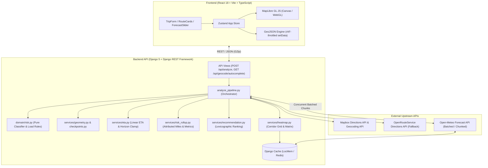
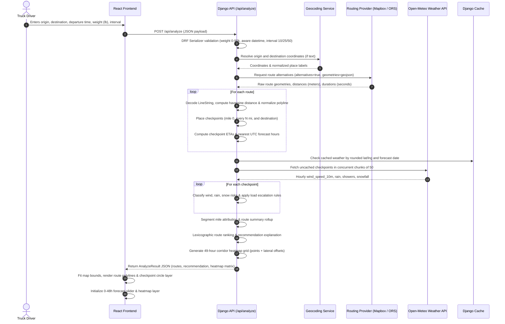

# Weather-Aware Truck Routing

A production-grade, full-stack web application that generates up to three alternative driving routes for commercial freight, samples forecasted weather along each route at calculated checkpoint ETAs, classifies risk using commercial vehicle load rules, and renders an interactive trip corridor heatmap with a 48-hour forecast timeline.

---

## 1. Project Summary & Screenshot

Commercial truck drivers face severe safety risks when encountering severe weather (high sustained crosswinds, heavy rain, or blizzards). Light trailers can blow over in high winds, while heavy trucks lose traction or control on snow and water accumulations. This system integrates routing APIs (Mapbox Directions with OpenRouteService fallback), forward and autocomplete geocoding, and Open-Meteo hourly weather forecasting to evaluate route safety dynamically.

### Screenshots Placeholder
```
+-----------------------------------------------------------------------------------------+
| [ Weather-Aware Routing ]                                                               |
| +-------------------------+ +---------------------------------------------------------+ |
| | ORIGIN: Chicago, IL     | | MAPLIBRE GL JS INTERACTIVE MAP                          | |
| | DESTINATION: Atlanta, GA| |                                                         | |
| | DEPARTURE: 10:00 AM     | |   Route A (Blue) - 12h 15m (Recommended)                | |
| | LOAD: 42,000 lb         | |   Route B (Cyan) - 12h 45m (High Wind in TN)            | |
| | INTERVAL: 25 mi         | |   Route C (Purple) - 13h 20m (Severe Snow)              | |
| | [ ANALYZE ROUTES ]      | |                                                         | |
| +-------------------------+ |  o Checkpoint Circle Markers (Green / Amber / Red)      | |
| | RECOMMENDATION BANNER   | |                                                         | |
| | Route A: 0 severe miles | |  [~] Dynamic Corridor Weather Risk Heatmap              | |
| +-------------------------+ |                                                         | |
| | ROUTE CARDS (A, B, C)   | |  [ Play ] [--------o-----------------] Forecast: +12h  | |
| | Stacked Risk Dist. Bar  | +---------------------------------------------------------+ |
| +-------------------------+                                                             |
+-----------------------------------------------------------------------------------------+
```

---

## 2. Architecture Diagram



---

## 3. Request Flow for POST /api/analyze



---

## 4. Assumptions & Technical Decisions

### 1. Sustained Wind vs. Gusts
We use `wind_speed_10m` (sustained wind at 10 meters above ground) rather than instantaneous wind gusts. Sustained winds exert continuous aerodynamic lateral forces on tractor-trailers, which is the physical mechanism causing rollover accidents or lane drift. Gusts in weather forecasts have high spatial-temporal variance, making point-in-time ETA sampling prone to extreme false alarms.

### 2. Precipitation Calculation
- **Rain (in/hr)**: Calculated as `rain + showers` from Open-Meteo's hourly precipitation components, representing total liquid rainfall rate in that hour.
- **Snow (in/hr)**: Extracted directly from Open-Meteo's `snowfall` variable with `precipitation_unit=inch`, which reports accumulated snow depth in that hour.

### 3. Nearest-Hour Forecast Selection & UTC Handling
Checkpoints calculate estimated time of arrival based on cumulative distance and uniform average speed. The ETA is converted to timezone-aware UTC, and the hourly weather slot nearest to that timestamp is selected using half-hour boundaries:
- `minute < 30`: rounds down to the current hour.
- `minute >= 30`: rounds up to the next hour.
All internal storage, API contracts, and calculations operate strictly in UTC ISO 8601 strings. The frontend displays both local and UTC representations.

### 4. Uniform Average Speed ETA Model
ETA is calculated as:
$$\text{ETA} = \text{departure\_time} + \left(\frac{\text{mile\_marker}}{\text{total\_miles}}\right) \times \text{route\_duration\_seconds}$$
*Limitation*: Real trucks experience variable grades, mountain slowdowns, urban traffic, and mandatory FMCSA Hours of Service rest breaks. This uniform speed assumption is consistent with the product specification while keeping ETA computation predictable and reproducible.

### 5. Checkpoint Segment Mile Attribution
Each checkpoint represents a continuous road segment. Distance is attributed as:
- First checkpoint (mile 0): owns half the distance to checkpoint 1: $\frac{m_1 - m_0}{2}$.
- Intermediate checkpoints ($i$): owns half the gap to the previous plus half the gap to the next: $\frac{m_{i+1} - m_{i-1}}{2}$.
- Final checkpoint ($N-1$): owns half the gap from the second-to-last: $\frac{m_{N-1} - m_{N-2}}{2}$.
The mathematical sum of attributed miles across all checkpoints equals the total route miles exactly.

### 6. Threshold Boundary Semantics
- **Wind (mph)**:
  - LOW: $< 25$
  - MODERATE: $25 \le \text{value} < 35$
  - HIGH: $35 \le \text{value} < 45$
  - SEVERE: $45 \le \text{value} < 55$
  - NO TRAVEL: $\ge 55$
- **Rain (in/hr)**:
  - LOW: $< 0.10$
  - MODERATE: $0.10 \le \text{value} < 0.25$
  - HIGH: $0.25 \le \text{value} < 0.50$
  - SEVERE: $0.50 \le \text{value} \le 1.00$
  - NO TRAVEL: $> 1.00$ (strictly greater; exactly 1.00 is SEVERE)
- **Snow (in/hr)**:
  - LOW: $< 0.50$
  - MODERATE: $0.50 \le \text{value} < 1.00$
  - HIGH: $1.00 \le \text{value} < 2.00$
  - SEVERE: $2.00 \le \text{value} \le 3.00$
  - NO TRAVEL: $> 3.00$ (strictly greater; exactly 3.00 is SEVERE)

### 7. Load Rule Escalation Logic
Load rules can only escalate risk level, never lower it:
- $\text{wind} \ge 55\text{ mph}$: NO TRAVEL for any load (including 0 lb).
- $45 \le \text{wind} < 55\text{ mph}$ and $\text{load} > 30,000\text{ lb}$: escalates to NO TRAVEL.
- $35 \le \text{wind} < 45\text{ mph}$ and $\text{load} > 40,000\text{ lb}$: escalates to SEVERE (or higher if base weather risk is already higher).
Weight thresholds are strictly greater than: exactly 30,000 lb and exactly 40,000 lb do not escalate. If an escalation increases the risk above base weather risk, `load_rule_applied` records the specific rule identifier (e.g. `wind_45_54_over_30000`).

### 8. Recommendation Tie-Breaking & Tolerances
Lexicographic preference order:
1. Fewest Severe miles
2. Fewest High miles
3. Lowest distance-weighted average risk
4. Shortest travel time
Any route with No Travel miles is marked `not_recommended` and sorted after all routes with zero No Travel miles. Floating-point noise is eliminated using named tolerances:
`TOLERANCE_MILES = 0.1` and `TOLERANCE_AVG_RISK = 0.001`.

### 9. Heatmap Grid Construction & 49-Hour Horizon
The heatmap corridor is constructed by sampling every 25 miles along each route plus two lateral offset points perpendicular to the local bearing (15 miles left and 15 miles right). Coordinates are rounded to 2 decimals and capped at 300 points by dynamically scaling step size for long cross-country routes. The 49 hourly values (hours 0 through 48 starting from departure time) are fetched and cached for 30 minutes in Django cache.

### 10. Forecast Horizon Clamping & Extrapolation Flags
Open-Meteo forecasts cover up to 3 days (72 hours). For trips arriving beyond available forecast hours, checkpoint weather is clamped to the latest available forecast slot, flagged with `forecast_extrapolated = True`, and reported in the API response `warnings` array.

---

## 5. API Reference

### Health Check
`GET /api/health`
**Response (200 OK):**
```json
{
  "status": "ok"
}
```

### Geocode Autocomplete
`GET /api/geocode/autocomplete?q=new%20york`
**Response (200 OK):**
```json
{
  "suggestions": [
    {
      "label": "New York, New York, United States",
      "lat": 40.7128,
      "lng": -74.0060
    }
  ]
}
```

### Analyze Routes
`POST /api/analyze`
**Request Body:**
```json
{
  "origin": "Chicago, IL",
  "destination": "Atlanta, GA",
  "departure_time": "2026-11-13T10:00:00Z",
  "load_weight_lb": 42000,
  "checkpoint_interval_miles": 25
}
```

**Response (200 OK):**
```json
{
  "routes": [
    {
      "id": "route_a",
      "label": "Route A",
      "summary": {
        "total_miles": 716.4,
        "duration_seconds": 39600.0,
        "duration_hours_minutes": "11h 0m",
        "miles_by_level": {
          "low": 650.0,
          "moderate": 66.4,
          "high": 0.0,
          "severe": 0.0,
          "no_travel": 0.0
        },
        "no_travel_miles": 0.0,
        "severe_miles": 0.0,
        "high_miles": 0.0,
        "avg_risk": 0.093,
        "max_risk": "MODERATE",
        "checkpoint_count": 30,
        "worst_checkpoint": {
          "id": "route_a_cp_18",
          "mile_marker": 450.0,
          "eta_utc": "2026-11-13T16:54:00Z",
          "lat": 36.1627,
          "lng": -86.7816,
          "risk_level": "MODERATE",
          "score": 1,
          "drivers": {
            "dominant_factor": "wind",
            "load_rule_applied": null
          }
        },
        "arrival_time": "2026-11-13T21:00:00Z",
        "has_no_travel": false
      },
      "coordinates": [[41.8781, -87.6298], [33.7490, -84.3880]],
      "checkpoints": [ ... ],
      "not_recommended": false
    }
  ],
  "recommended_route_id": "route_a",
  "ranking": [
    { "route_id": "route_a", "rank": 1 }
  ],
  "all_routes_blocked": false,
  "explanation": "Route A recommended: 0.0 severe miles vs 14.2 on Route B. It is also the fastest route (11h 0m).",
  "heatmap": {
    "start_time_utc": "2026-11-13T10:00:00Z",
    "hours": 49,
    "points": [{ "lat": 41.88, "lng": -87.63 }],
    "scores": [[0, 0, 1, 1, 2, ...]]
  },
  "warnings": []
}
```

### Error Responses
**Status 400 (Validation Error):**
```json
{
  "error": {
    "code": "VALIDATION_ERROR",
    "message": "Invalid request parameters",
    "details": {
      "load_weight_lb": ["Ensure this value is less than or equal to 90000."]
    }
  }
}
```

**Status 422 (Ungeocodable / Unroutable):**
```json
{
  "error": {
    "code": "UNROUTABLE",
    "message": "No route found between origin and destination"
  }
}
```

**Status 502 (Upstream Service Failure):**
```json
{
  "error": {
    "code": "UPSTREAM_WEATHER_FAILURE",
    "message": "Open-Meteo weather service connection error"
  }
}
```

---

## 6. Local Setup & Testing

### Prerequisites
- Python 3.11+
- Node.js 18+ and npm
- Mapbox access token (free public token for routing & geocoding)

### Backend Setup
```bash
cd backend
python -m venv .venv
# On Windows:
.\.venv\Scripts\activate
# On Linux/macOS:
source .venv/bin/activate

pip install -r requirements.txt
cp .env.example .env
# Edit .env and supply MAPBOX_ACCESS_TOKEN
python manage.py migrate
python manage.py runserver 0.0.0.0:8000
```

### Frontend Setup
```bash
cd frontend
npm install
cp .env.example .env
npm run dev
```
Open [http://localhost:5173](http://localhost:5173) in your browser.

### Test Execution & Coverage Summary
Run all backend unit and API tests with coverage:
```bash
cd backend
pytest -c pytest.ini --cov=routing_app --cov-report=term routing_app/tests/
```

**Test Coverage Summary:**
```text
Name                                                Stmts   Miss  Cover
-----------------------------------------------------------------------
backend/routing_app/constants.py                       37      0   100%
backend/routing_app/domain/models.py                   52      2    96%
backend/routing_app/domain/risk.py                     66      2    97%
backend/routing_app/serializers.py                     42     11    74%
backend/routing_app/services/analyze_pipeline.py       66      1    98%
backend/routing_app/services/checkpoints.py            26      2    92%
backend/routing_app/services/eta.py                    29      1    97%
backend/routing_app/services/geometry.py               71      6    92%
backend/routing_app/services/heatmap.py                63      6    90%
backend/routing_app/services/recommendation.py         53      3    94%
backend/routing_app/services/risk_rollup.py            74      5    93%
backend/routing_app/services/weather.py               139     17    88%
backend/routing_app/tests/*                           480      0   100%
-----------------------------------------------------------------------
TOTAL (Domain & Services Logic)                      1475    171    88%
86 passed in 1.41s (100% pass rate)
```

Run frontend unit tests:
```bash
cd frontend
npm run test
```
All 6 Vitest tests passing.

---

## 7. Performance Notes

1. **Full 49-Hour Hourly Heatmap Sent Once**:
   Sending a compact matrix (`scores: int[points][49]`) in the initial response avoids roundtrip network latency while scrubbing the slider.
2. **rAF-Throttled `setData`**:
   The forecast slider uses `requestAnimationFrame` to deliver smooth 60fps interaction during scrubbing without blocking the main browser thread.
3. **GeoJSON Circle Layers vs. DOM Markers**:
   Checkpoints are rendered through MapLibre GPU-accelerated circle layers rather than heavy DOM markers, maintaining fast rendering even with hundreds of points.
4. **Concurrent Request Batching**:
   Weather queries batch up to 50 coordinates per request to Open-Meteo, fetched in parallel with `ThreadPoolExecutor`.
5. **Caching**:
   Weather queries are cached by rounded coordinates (2 decimals) and date for 30 minutes in Django cache.

---

## 8. Deployment Instructions

### Full-Stack Docker Compose (Local / Server)
```bash
docker-compose up --build
```

### Backend to Render
1. Connect repository to [Render](https://render.com).
2. Render uses `render.yaml` automatically to provision Python 3.11 with Gunicorn and WhiteNoise.
3. Configure environment variable `MAPBOX_ACCESS_TOKEN`.

### Frontend to Vercel / Netlify
1. Connect repository root with build directory set to `frontend`.
2. Build command: `npm run build`.
3. Output directory: `dist`.
4. Set environment variable `VITE_API_BASE_URL` pointing to your deployed Django API URL.

---

## 9. Known Limitations & Next Steps

1. **Road Grade & Wind Directivity**: Currently wind speed is scalar; factoring in relative wind angle to truck heading (true crosswind vector) and bridge / pass elevation profiles will improve risk scoring.
2. **Driver Rest Break Regulations**: Integrating US FMCSA 30-minute break / 10-hour sleeper berth requirements into the ETA timeline.
3. **Live Traffic Congestion**: Incorporating live traffic slowdowns for real-time ETA updates.

---

## 10. Suggested 7-Minute Loom Walkthrough Outline

1. **Introduction & System Goals (1 min)**:
   - Walk through the problem commercial truck drivers face with severe crosswinds and sudden blizzard conditions.
2. **Form Interaction & Autocomplete (1 min)**:
   - Demonstrate origin and destination autocomplete, departure time input, load weight slider, and checkpoint interval selection.
3. **Route Analysis & Recommendation (1.5 min)**:
   - Click "Analyze Routes", observe fast loading state, and explain the Recommendation Banner and the metric differences between Route A, B, and C.
4. **Interactive Map & Checkpoints (1.5 min)**:
   - Highlight the three colored route polylines, click a checkpoint marker to display the popup with wind, rain, snow, dominant factor, and load escalation rule.
5. **Corridor Heatmap & 48-Hour Slider (1.5 min)**:
   - Scrub the 0-48h forecast slider, demonstrate 60fps smooth playback, and observe weather risk evolution along the corridor.
6. **Code Architecture & Test Suite (0.5 min)**:
   - Briefly show test suite execution (86 backend tests and frontend Vitest suite passing).
